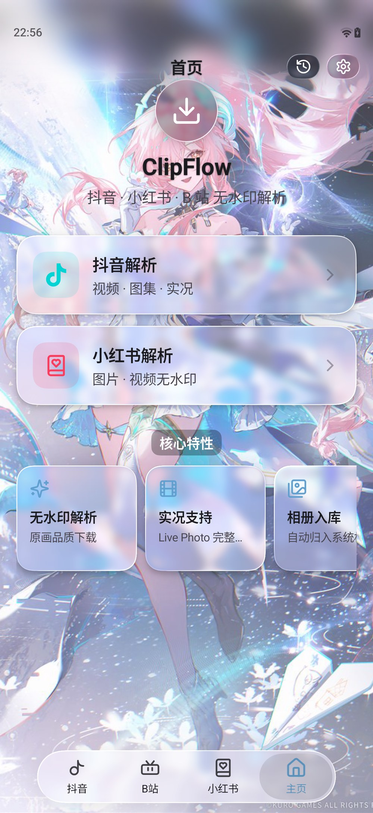
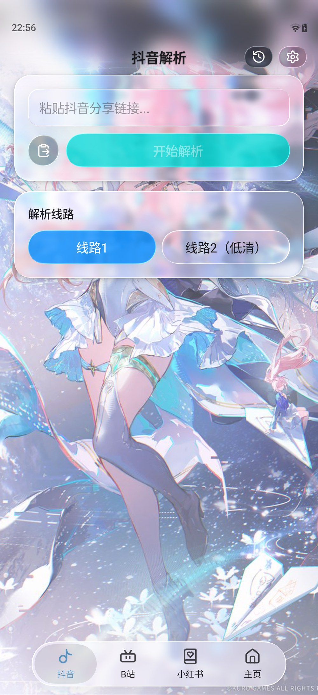
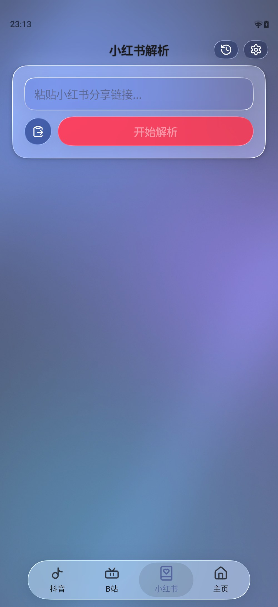
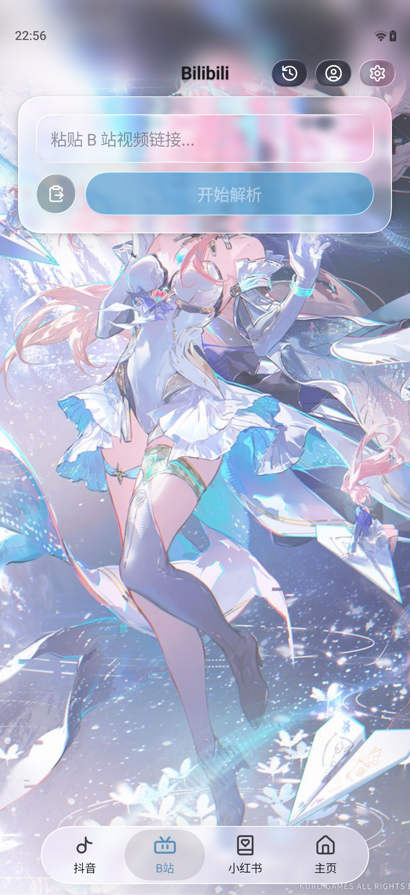
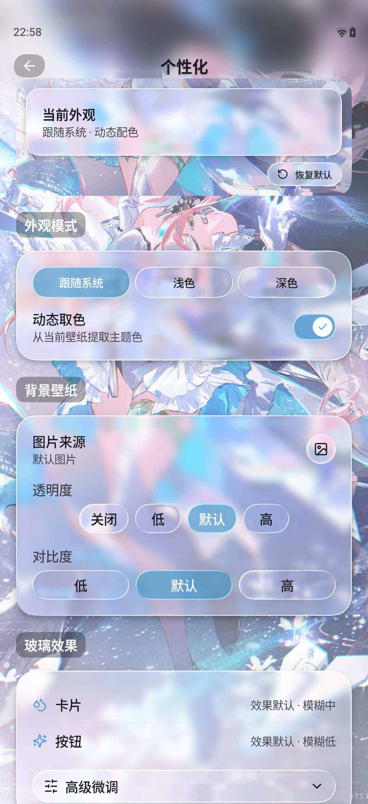
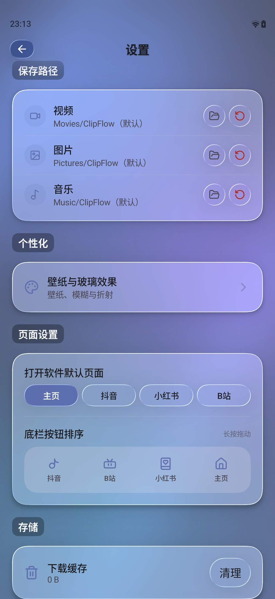
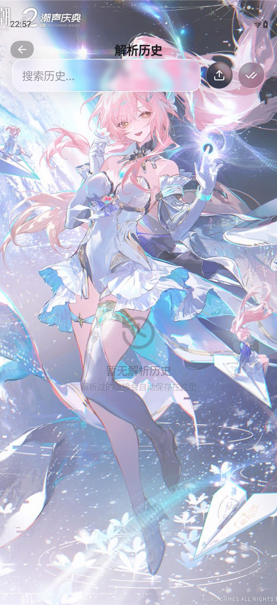

# ClipFlow

> 抖音 · 小红书 · B 站 无水印解析下载

复制作品分享链接，粘贴到 ClipFlow，一键解析并保存视频、图集、实况照片和音乐。界面基于 Jetpack Compose 与液态玻璃效果构建，支持壁纸动态取色、底栏拖动排序和 Android 预测性返回。

<p align="center">
  
  
  
</p>

<p align="center">
  
  
</p>
<p align="center">
  
  
</p>
<p align="center">
  
  
</p>
<p align="center">
  
</p>

<p align="center"><sub>截图拍摄于 1272×2772 / 450dpi 的 1.5K 屏幕参数；首页“核心特性”为横向滑动卡片。</sub></p>

## 下载

[下载最新版 APK](https://github.com/qihe114514/ClipFlow/releases/latest) · [查看所有版本](https://github.com/qihe114514/ClipFlow/releases)

当前版本：**v4.2.2**（versionCode **96**）· 最低支持：**Android 10（API 29）** · 目标 SDK：**API 37**

## 功能

### 三个平台的解析

| 平台 | 支持内容 | 说明 |
| --- | --- | --- |
| 抖音 | 视频、图集、实况照片、音乐 | 主线路解析出的主链接标记为“原画”，实际清晰度取决于平台返回的资源；线路 2 为低清备选 |
| 小红书 | 图文笔记、视频 | 图片与视频无水印保存，按项下载 |
| B 站 | 普通视频、短链、多分 P | 扫码登录后按当前账号权限列出可用清晰度；DASH 音视频自动合成 MP4 |

“原画”是主链接的标记，不代表应用做了画质增强。最终能否得到 4K，取决于原视频本身和平台返回的资源；普通清晰度的视频不会因为下载工具而变成 4K。

### 下载与保存

- 按清晰度和内容类型选择下载项，图集按图片逐项下载。
- 抖音实况照片会完整保存视频与图片部分，并归入系统相册。
- 下载在前台服务中继续执行，通知栏显示进度；支持取消和完成后直接打开。
- 视频、图片、音乐分别保存，可在设置中为三类内容指定不同目录。
- 已保存的下载项会显示完成状态；重新解析不会把旧任务的完成状态带进新结果。

### 界面与个性化

- **液态玻璃**：顶栏、底栏、卡片、弹窗和下载面板使用 Kyant Backdrop 的模糊、折射与高光效果。
- **连续圆角**：卡片、输入框、缩略图、弹窗和分组容器统一使用 G2 / squircle 连续曲率圆角。
- **图标体系**：全应用使用 Lucide 线性图标，保持 24dp / 2dp 描边节奏；抖音、B 站等品牌图标使用同粗细的线性版本。
- **壁纸**：可选择自定义图片，调整透明度与对比度；关闭壁纸时卡片切换为不依赖背景采样的实体表面，并使用实线边框提升对比度。
- **动态取色**：壁纸可见时从当前壁纸提取主题色；关闭壁纸后，Android 12+ 使用系统 Monet 取色，Android 10 / 11 回退到内置品牌色。
- **外观模式**：跟随系统、浅色、深色。
- **页面设置**：可选择启动页；底栏图标支持长按拖动排序，并保留无障碍左移 / 右移操作。
- **预测性返回**：Android 14+ 上，设置、历史、关于等二级页面会跟随返回手势实时过渡，取消手势自动回弹。

### 解析历史

- 每次成功解析都会自动写入本地历史，按日期分组。
- 支持搜索，点击记录可重新打开对应解析结果。
- 历史与设置只保存在本机，不会同步到服务器。

## 使用方法

1. 在抖音、小红书或 B 站中分享作品，选择“复制链接”。
2. 打开 ClipFlow，进入对应平台，点击输入框旁的粘贴按钮，再点击“开始解析”。
3. 选择需要的清晰度或图片，点击下载；完成后可从通知、相册或文件管理器打开。

B 站需要更高清晰度时，先在 B 站页面右上角扫码登录。登录会话保存在本机 Keystore 加密存储中，只用于请求当前账号有权访问的资源。

## 默认保存位置

| 内容 | 位置 |
| --- | --- |
| 视频 | `Movies/ClipFlow` |
| 图片 | `Pictures/ClipFlow` |
| 音乐 | `Music/ClipFlow` |

可以在“设置 → 保存路径”中分别修改，或使用右侧按钮恢复默认目录。

## 常见问题

**标注“原画”但清晰度一般？** “原画”表示解析结果指向主链接，并不代表应用进行了超分或码率提升。清晰度由原视频和平台返回的资源决定。

**解析失败怎么办？** 重新复制分享链接，确认网络正常后再试。已删除、仅好友可见、地区受限或临时下架的内容可能无法解析。

**线路 2 是什么？** 抖音的备用解析线路，稳定性更好但通常只提供较低清晰度。切换线路后，已有链接会自动重新解析。

**B 站为什么清晰度不全？** 清晰度由账号权限和视频本身决定。登录后应用会按当前账号能访问的范围列出选项，不绕过付费、地区或会员限制。

**覆盖安装提示签名不一致？** 正式版本使用固定发布证书签名。请从 Releases 页面下载同一来源的 APK；自行构建的版本需要先卸载再用自己的签名安装。

**登录安全吗？** B 站会话保存在本机 Keystore 加密存储中。退出登录会清除本地会话和 WebView Cookie；会话失效时清除本地登录会话，需要重新扫码。

**应用会读剪贴板吗？** 只在你点击粘贴按钮时读取一次剪贴板文本，不会在后台监听，也不会把剪贴板内容上传到 ClipFlow 自有服务。

## 隐私与权限

- 需要网络、通知、前台服务与安装未知应用权限；视频、图片和音乐通过 MediaStore / SAF 写入，不需要额外的存储运行时权限。
- 粘贴的作品链接会发送给第三方解析接口（`api.bugpk.com`、`api-new.ifphp.com`、`douyin.wtf`）；B 站登录与解析请求会发送到 B 站官方接口（`api.bilibili.com`、`passport.bilibili.com`）。
- 解析历史和应用设置保存在本机；下载任务状态只在当前会话内保留，下载文件写入你选择的目录。
- 应用内统计 SDK 在用户同意隐私政策后才初始化；在“关于 → 隐私”中撤回同意会停止后续采集。
- 请只下载自己有权保存和使用的内容，并遵守相关平台的服务条款与版权规定。

## 技术栈

| 类别 | 技术 |
| --- | --- |
| 语言 | Kotlin |
| UI | Jetpack Compose + Material 3 |
| 架构 | MVVM（ViewModel + StateFlow） |
| 导航 | Navigation Compose 2.8.9 |
| 网络 | Retrofit 2 + OkHttp 4 + Gson |
| 图片 | Coil |
| 本地数据 | Room、DataStore |
| 播放与合成 | Media3（ExoPlayer）、Android MediaMuxer |
| 视觉 | Kyant Backdrop、连续曲率圆角、Lucide 图标 |
| 最低 / 目标 SDK | Android 10（29）/ API 37 |
| 构建 | JDK 21 + Android Gradle Plugin，KSP |

## 构建

需要 JDK 21 与 Android SDK 37：

```bash
./gradlew assembleDebug
```

发布构建需要在 `signing/clipflow-release.keystore` 放置签名文件（不入库），然后执行：

```bash
./gradlew assembleRelease
```

生成的 APK 位于 `app/build/outputs/apk/release/`。项目路径包含非 ASCII 字符时，`gradle.properties` 中的 `android.overridePathCheck=true` 必须保留。

## 开源信息

- GitHub：[qihe114514/ClipFlow](https://github.com/qihe114514/ClipFlow)
- 许可证：GNU General Public License v3.0（GPLv3），完整协议见 [LICENSE](LICENSE)。
- 第三方组件：Jetpack Compose、AndroidX、Navigation Compose、Room、DataStore、Media3、Retrofit、OkHttp、Gson、Coil、Kyant Backdrop、Accompanist、Lucide（ISC）和友盟 SDK 等，分别遵循各自项目的许可证与使用条款。
- 更新日志见 [CHANGELOG.md](CHANGELOG.md)，各版本说明见根目录的 `RELEASE_NOTES_v*.md`。

ClipFlow 按现状提供，不保证第三方平台接口、资源链接或登录服务持续可用。平台规则、版权归属和内容访问权限由相应平台及权利人决定。
